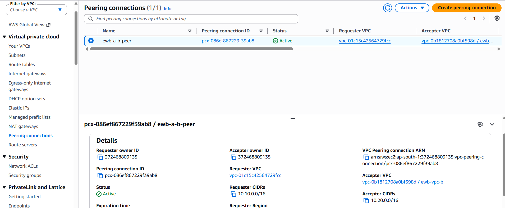
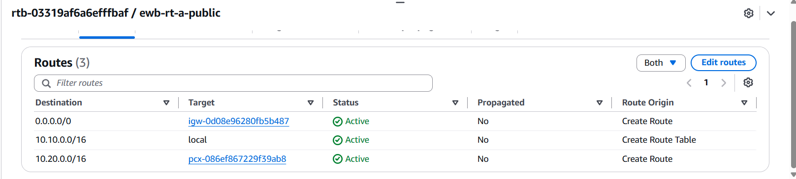
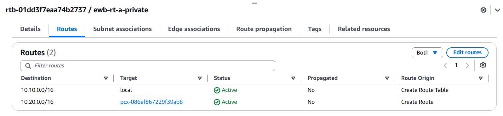
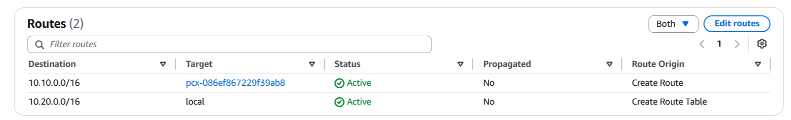
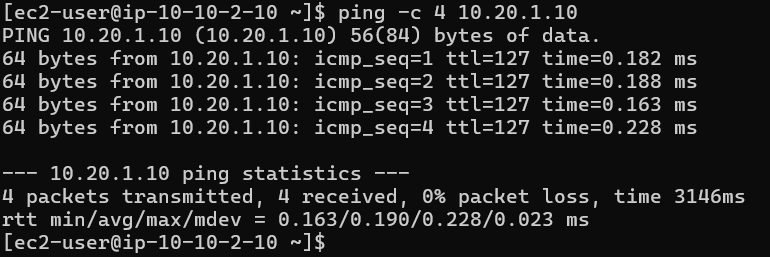
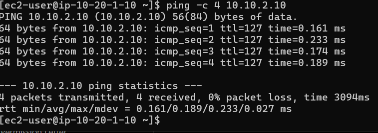
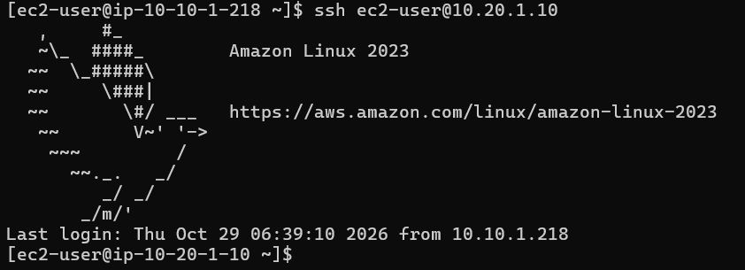
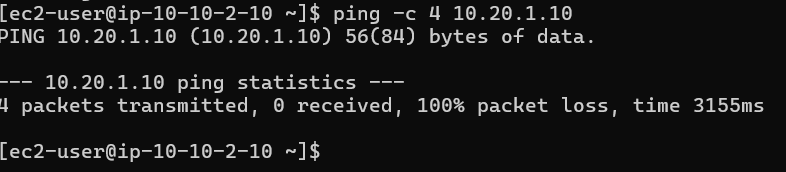
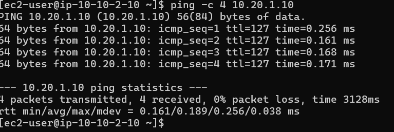

# AWS VPC Peering Project

## Project Overview
This project demonstrates secure private communication between two Amazon Virtual Private Clouds (VPCs) using AWS VPC Peering. It uses private EC2 instances, route tables, security groups, and a bastion host to validate connectivity.

## Architecture

The project uses two VPCs in the AWS Mumbai Region (`ap-south-1`).
VPC Peering provides private communication between their CIDR ranges.

**Traffic design:** Administrative SSH access goes through the bastion host. App-A and App-B communicate over private IP addresses through the peering connection and the configured route tables.

**VPC Peering:** Connects VPC A and VPC B, allowing private communication through configured routes.

## AWS Services Used
- Amazon VPC
- VPC Peering
- Amazon EC2
- Route Tables
- Internet Gateway
- Security Groups
- AWS IAM

## Implementation
1. Created two VPCs with non-overlapping CIDR ranges.
2. Created public and private subnets.
3. Configured route tables and subnet associations.
4. Created and activated a VPC peering connection.
5. Added routes to the remote VPC CIDR in the required route tables.
6. Configured security groups to allow only the required administrative and ICMP traffic.
7. Launched a bastion host and two private EC2 instances.
8. Connected to the private instances through SSH and tested communication in both directions.

## Validation Results
- SSH access from the bastion host to App-A: **Successful**
- SSH access from the bastion host to App-B: **Successful**
- Ping from App-A to App-B: **Successful**
- Ping from App-B to App-A: **Successful**
- Packet loss during the App-A to App-B ping test: **0%**

## Security Considerations
- Private application instances have no public IPv4 addresses.
- Bastion SSH access is restricted to a specific client IP address.
- Security-group rules limit administrative and test traffic.
- Private keys and AWS credentials must never be committed to this repository.

## Learning Outcomes
This project strengthened my practical understanding of AWS networking, subnet design, route tables, VPC Peering, EC2 administration, security groups, SSH, and private network troubleshooting.

## Project Status
Core networking and bidirectional connectivity tests completed successfully.

## Project Evidence

The following screenshots document the configuration and connectivity tests performed during the project.

### 1. VPC Peering Connection

### 2. Route Table Configuration

**VPC-A Public Route Table**

**VPC-A Private Route Table**

**VPC-B Private Route Table**

### 3. Connectivity Tests

**App-A to App-B**

**App-B to App-A**

### 4. Bastion Host Access

### 5. Failure and Recovery

